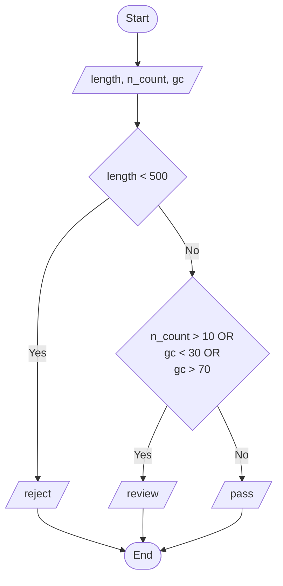
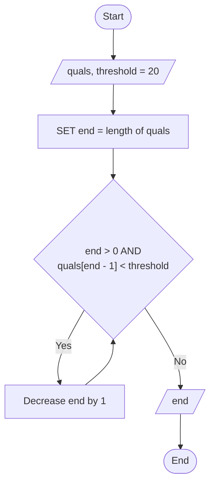

## Problem
Input:
- length: Total number of bases in a DNA sequence
- n_count: Number of N bases in the sequence
- gc: GC percentage of the sequence

Output:
- reject: Sequence length is less than 500 bases
- review: N count is more than 10 or GC percentage is below 30 or above 70
- pass: Sequence meets all the quality requirements

Constraints:
- Minimum sequence length is 500 bases.
- Maximum allowed N count is 10.
- GC percentage must be between 30% and 70%
- The length condition must be checked first.
- GC percentage exactly 30% or 70% is acceptable.

## Pseudocode
- classify_read:
1. Start
2. Input length,n_count,gc
3. 3.1 IF length < 500
    3.1.1 Output"reject"

    3.2 ELSE IF n_count > 10 OR gc < 30 OR gc > 70
    3.2.1 Output "review"

    3.3 ELSE
    3.3.1 Output "pass"
   3.4 End IF
4. End

- trim_low_quality
1. Start
2. Input quals, threshold = 20
3. SET end = length of quals
4. WHILE end > 0 AND quals[end-1] < threshold = 20
    4.1 Decrease end by 1
    4.2 End WHILE
5. Return end
6. END

## Flowchart
### classify_read Flowchart

### trim_low_quality Flowchart

## Trace
| sample | length | n_count | gc | length < 500? | N > 10 or GC outside 30-70? | decision|
|---|---|---|---|---|---|---|
| R003 | 420 | 0 | 68.5 | YES | --- | reject |  
| R004 | 500 | 10 | 45.0 | NO | NO | pass |
| R005 | 640 | 3 | 72.4 | NO | YES | review |
| R007 | 499 | 0 | 50.0 | YES | --- | reject |